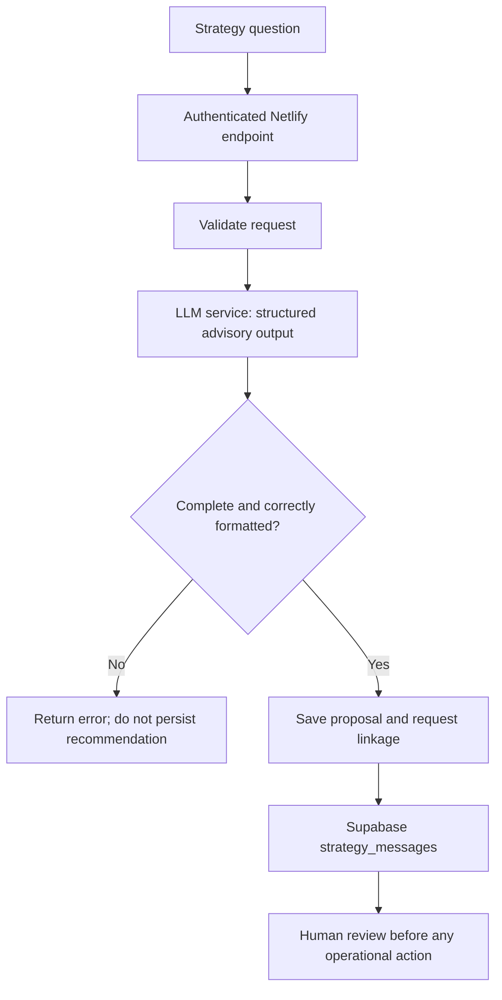

# SOUVEX — Governed LLM Strategy Assistant

**A sanitized engineering case study in building useful, bounded AI workflows.**

SOUVEX is an early-stage platform intended to help specialty contractors find and evaluate relevant procurement opportunities. As part of the project, I developed a **server-side LLM-assisted strategy capability** that generates structured, advisory recommendations for the platform's pilot operations.

This public case study focuses on the engineering decisions around **model access, output validation, evidence, persistence, and human oversight**. It is **not** the production source code or a demonstration of an operational AI RFP analyzer.

## Why this is interesting

An LLM can return a convincing recommendation without reliable supporting evidence. Constraining the model to a format helps operationally, but **a well-formed response is not necessarily a correct response**. This project explores a practical way to separate model-generated suggestions from application-authorized actions.

### Implemented in the private application (reviewed source)

- Server-side model integration in a Netlify function, rather than exposing a model API key in the browser.
- Authenticated access to the strategy endpoint; request-size and input validation.
- Domain-specific instructions that distinguish verified facts from hypotheses and request three measurable actions.
- Explicit checks for incomplete model responses and required action structure before saving suggestions.
- Supabase persistence of request and recommendation records with conversation identifiers.
- Automated unit tests covering authentication, invalid requests, response completeness, and persistence behavior.

**Not established by this case study:** a successful live production run, quantitative recommendation-quality improvements, a completed two-way ChatGPT/Gemini workflow, or a deployed AI-powered RFP document analyzer. Opportunity matching elsewhere in the app currently uses deterministic rules.

## Architecture — reviewed private implementation



The application controls authorization, request handling, persistence, and downstream actions. The LLM generates proposals; it does not independently approve deployments, outreach, or spending.

## Run the synthetic demonstration

The `demo/` folder is **new educational code**, created for this public case study. It is **not a copy** of the private SOUVEX implementation. It uses fictitious procurements, mocked LLM output, and no network calls or credentials.

```bash
node demo/run.mjs
node --test tests/*.test.mjs
```

The demo illustrates three boundaries: source identifiers must belong to the provided evidence set, actions must be structurally complete, and recommendations remain proposals awaiting review. It does **not** verify factual or causal correctness of arbitrary natural-language claims.

## Read more

- [Engineering case study](docs/CASE_STUDY.md) — design decisions, limitations, and reliability questions
- [Evaluation plan](docs/EVALUATION_PLAN.md) — proposed experiments and measurable outcomes
- [Demo implementation](demo/run.mjs) — self-contained, synthetic example
- [Application summary](docs/NOTABLE_WORK.md) — short description suitable for a technical portfolio

## Technology context

The private implementation uses **JavaScript, Netlify Functions, a Gemini API integration, Supabase, and Node-based automated tests**. The synthetic demonstration requires only Node.js 18+ and uses no third-party dependencies.

## Disclosure and attribution

This repository is a **sanitized technical explanation** of an independently developed project. No production secrets, customer records, procurement data, private repository code, or proprietary Freddie Mac materials are included. Example opportunities and outputs are fictitious.

**Status:** Public case-study materials and demonstration only; not a production AI service.
